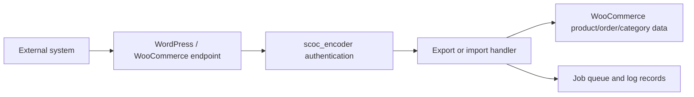

# woocommerce-plugin

A legacy WordPress/WooCommerce plugin for synchronising catalog, inventory, and order data with an external integration layer.

## Objective

This project implements a WooCommerce data bridge. It exposes plugin endpoints that allow an external system to request product, category, inventory, and order information from a WooCommerce store, and it accepts XML-based import payloads to update products and stock data.

The code is designed for a store operator or integration partner that needs bulk product and order export/import automation. It is not a standalone SaaS application and is not a modern API-first service.

## Architecture

This repository is a legacy PHP plugin. It runs inside WordPress and interacts with WooCommerce objects directly. The main flow is:

- request arrives at a plugin endpoint under `src/scwoo/export` or `src/scwoo/import`
- credentials are checked by the auth layer
- WooCommerce product, variation, order, and category data is read or written
- XML payloads are processed and stored as queued job records for background import/export handling

## Coding style and platform

- Language: PHP
- Platform: WordPress with WooCommerce
- Plugin code is stored under `src/scwoo`
- Legacy plugin conventions, direct WordPress hooks, and XML-based sync endpoints are used throughout
- Configuration values and credentials are expected to be supplied by the hosting store, not committed to source control

## Installation and deployment

### Requirements

- WordPress installation with WooCommerce enabled
- PHP compatible with the site runtime
- Access to the WordPress plugin folder on the server

### Upload

Copy the contents of `src/scwoo` into the plugin directory for the WordPress installation, for example:

- `wp-content/plugins/woocommerce-plugin/`

### Enable

1. Upload the plugin files to the WordPress installation.
2. Activate the plugin from the WordPress admin panel.
3. Confirm the plugin endpoints are reachable on the live site.

### Configure

The plugin expects configuration values such as API keys, admin credentials, and endpoint-specific settings to be supplied by the target store or secure deployment configuration. No real values are committed in this repository.

### Verify

Use the plugin endpoints to confirm authentication and data export is working. Examples:

- `https://shop.example.com/wp-content/plugins/woocommerce-plugin/export/auth.php?consumer_key=CHANGE_ME&consumer_secret=CHANGE_ME`
- `https://shop.example.com/wp-content/plugins/woocommerce-plugin/export/product.php?rowsperpage=2&currentpageindex=1&sku=EXAMPLE`
- `https://shop.example.com/wp-content/plugins/woocommerce-plugin/import`

## Security and compliance notes

This repository is aligned with GDPR principles and maps to ISO 27001 controls for least-privilege and secure handling of credentials. It does not claim formal certification.

Security measures in this repo include:

- no real credentials committed to source control
- example values replaced with `CHANGE_ME`
- secure HTTP requirement for credential-bearing requests in the auth layer
- no production store URLs or client details retained in the public code

## Known limits and next steps

- This is an older PHP plugin, not a modern application architecture.
- Authentication patterns still reflect legacy WordPress plugin practices and should be reviewed in a live store.
- Direct query-string credentials are not suitable for public deployments and should be replaced by platform-managed configuration in a production environment.
- Real-world validation should be performed on a test WordPress store before deployment to a production site.
- A full modernisation pass would require a platform review, deployment review, and migration planning outside the scope of this repository.

## License and author

Author: Raman Basu

Repository: github.com/ramanbasu-business/woocommerce-plugin

This repository is intended for portfolio and showcase use only. Confirm rights before public publication or redistribution of any client-specific code, data, or credentials.
